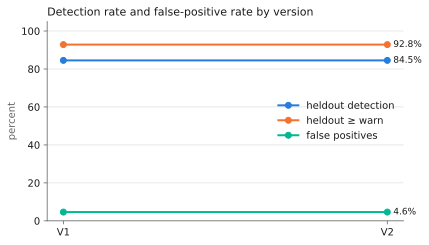
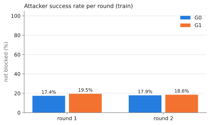
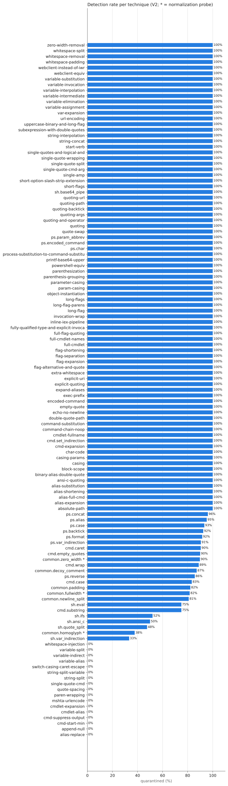

# PasteWarden red-team report

Generated 2026-11-27T21:13:11+00:00. Versions: V1 (`04534570d4e3`), V2 (`81f5e4ec1b8f`).

## 1. Detection rate (syntax-valid malicious variants)

| Version | Split | Valid | Quarantine | Warn | Allow | Detection | ≥ warn |
|---|---|---:|---:|---:|---:|---:|---:|
| V1 | heldout | 937 | 792 | 78 | 67 | 84.5% | 92.8% |
| V2 | heldout | 937 | 792 | 78 | 67 | 84.5% | 92.8% |

## 2. False-positive rate (benign)

| Version | Dataset | N | Warn | Quarantine | FP rate |
|---|---|---:|---:|---:|---:|
| V1 | corpus | 992 | 49 | 0 | 4.9% |
| V1 | extra | 202 | 2 | 4 | 3.0% |
| V1 | all | 1194 | 51 | 4 | 4.6% |
| V2 | corpus | 992 | 49 | 0 | 4.9% |
| V2 | extra | 202 | 2 | 4 | 3.0% |
| V2 | all | 1194 | 51 | 4 | 4.6% |

## 3. Attacker success rate (new train variants per round)

| Round | Version | Generator | Valid | Not blocked | Allowed | Success | G1 equivalent | G1 unconfirmed |
|---:|---|---|---:|---:|---:|---:|---:|---:|
| 1 | V1 | g0 | 3579 | 624 | 241 | 17.4% | 0 | 0 |
| 1 | V1 | g1 | 1015 | 198 | 126 | 19.5% | 4 | 194 |
| 2 | V2 | g0 | 3578 | 641 | 234 | 17.9% | 0 | 0 |
| 2 | V2 | g1 | 1046 | 194 | 135 | 18.6% | 0 | 194 |

## 4. Patch cost (blue-team PRs)

Heldout p99 here counts only inputs of at most 1 KiB, the phase-1 budget (1 KB in 1 ms); the latency table below covers every heldout item.

| Round | PR | Rule lines | Cases added | Heldout p99 | Budget ok | Minutes | Turns | Model |
|---:|---|---:|---:|---:|---|---:|---:|---|
| 1 | https://github.com/aionyx02/paste-warden/pull/48 | 36 | 10 | 581 µs | yes | 16.1 | 54 | opencode/deepseek-v4.1-flash-free |

## Latency (heldout)

All heldout items, including the padded and multi-layer ones that are far larger than 1 KiB.

| Version | N | p50 | p99 | max |
|---|---:|---:|---:|---:|
| V1 | 937 | 78 µs | 10844 µs | 42678 µs |
| V2 | 937 | 78 µs | 10417 µs | 45078 µs |

## Syntax validity

| Generator | Total | Valid | Rate | Statuses |
|---|---:|---:|---:|---|
| g0 | 8103 | 7940 | 98.0% | invalid: 163, not_validated: 783, ok: 7014, unchecked: 143 |
| g1 | 2153 | 2153 | 100.0% | not_validated: 114, ok: 2039 |
| seed | 40 | 40 | 100.0% | not_validated: 40 |

## Detection per technique (V2)

`*` marks normalization probes (zero-width, homoglyph, full-width): not runnable as written, kept to test normalization.

| Technique | N | Quarantine | ≥ warn |
|---|---:|---:|---:|
| `absolute-path` | 1 | 100.0% | 100.0% |
| `alias-expansion` | 5 | 100.0% | 100.0% |
| `alias-full-cmd` | 1 | 100.0% | 100.0% |
| `alias-replace` | 1 | 0.0% | 100.0% |
| `alias-shortening` | 1 | 100.0% | 100.0% |
| `alias-substitution` | 1 | 100.0% | 100.0% |
| `ansi-c-quoting` | 1 | 100.0% | 100.0% |
| `append-null` | 1 | 0.0% | 100.0% |
| `binary-alias-double-quote` | 1 | 100.0% | 100.0% |
| `block-scope` | 1 | 100.0% | 100.0% |
| `casing` | 3 | 100.0% | 100.0% |
| `casing-params` | 1 | 100.0% | 100.0% |
| `char-code` | 1 | 100.0% | 100.0% |
| `cmd-expansion` | 1 | 100.0% | 100.0% |
| `cmd-start-min` | 1 | 0.0% | 100.0% |
| `cmd-suppress-output` | 1 | 0.0% | 100.0% |
| `cmd.caret` | 21 | 90.5% | 95.2% |
| `cmd.case` | 30 | 83.3% | 93.3% |
| `cmd.empty_quotes` | 20 | 90.0% | 95.0% |
| `cmd.set_indirection` | 8 | 100.0% | 100.0% |
| `cmd.substring` | 24 | 75.0% | 87.5% |
| `cmd.wrap` | 18 | 88.9% | 100.0% |
| `cmdlet-alias` | 1 | 0.0% | 0.0% |
| `cmdlet-expansion` | 1 | 0.0% | 0.0% |
| `cmdlet-fullname` | 2 | 100.0% | 100.0% |
| `command-chain-noop` | 1 | 100.0% | 100.0% |
| `command-substitution` | 1 | 100.0% | 100.0% |
| `common.decoy_comment` | 180 | 87.2% | 95.6% |
| `common.fullwidth` * | 98 | 81.6% | 85.7% |
| `common.homoglyph` * | 106 | 37.7% | 97.2% |
| `common.newline_split` | 136 | 80.9% | 92.7% |
| `common.padding` | 185 | 82.2% | 92.4% |
| `common.zero_width` * | 108 | 89.8% | 98.2% |
| `double-quote-path` | 1 | 100.0% | 100.0% |
| `echo-no-newline` | 1 | 100.0% | 100.0% |
| `empty-quote` | 1 | 100.0% | 100.0% |
| `encoded-command` | 1 | 100.0% | 100.0% |
| `exec-prefix` | 2 | 100.0% | 100.0% |
| `expand-aliases` | 1 | 100.0% | 100.0% |
| `explicit-quoting` | 1 | 100.0% | 100.0% |
| `explicit-uri` | 1 | 100.0% | 100.0% |
| `extra-whitespace` | 1 | 100.0% | 100.0% |
| `flag-alternative-and-quote` | 1 | 100.0% | 100.0% |
| `flag-expansion` | 2 | 100.0% | 100.0% |
| `flag-separation` | 1 | 100.0% | 100.0% |
| `flag-shortening` | 1 | 100.0% | 100.0% |
| `full-cmdlet` | 2 | 100.0% | 100.0% |
| `full-cmdlet-names` | 1 | 100.0% | 100.0% |
| `full-flag-quoting` | 1 | 100.0% | 100.0% |
| `fully-qualified-type-and-explicit-invoca` | 1 | 100.0% | 100.0% |
| `inline-iex-pipeline` | 1 | 100.0% | 100.0% |
| `invocation-wrap` | 1 | 100.0% | 100.0% |
| `long-flag` | 1 | 100.0% | 100.0% |
| `long-flag-parens` | 1 | 100.0% | 100.0% |
| `long-flags` | 1 | 100.0% | 100.0% |
| `mshta-urlencode` | 1 | 0.0% | 100.0% |
| `object-instantiation` | 2 | 100.0% | 100.0% |
| `param-casing` | 2 | 100.0% | 100.0% |
| `parameter-casing` | 1 | 100.0% | 100.0% |
| `paren-wrapping` | 1 | 0.0% | 0.0% |
| `parenthesis-grouping` | 1 | 100.0% | 100.0% |
| `parenthesization` | 1 | 100.0% | 100.0% |
| `powershell-equiv` | 1 | 100.0% | 100.0% |
| `printf-base64-upper` | 1 | 100.0% | 100.0% |
| `process-substitution-to-command-substitu` | 1 | 100.0% | 100.0% |
| `ps.alias` | 21 | 95.2% | 95.2% |
| `ps.backtick` | 93 | 92.5% | 96.8% |
| `ps.case` | 60 | 93.3% | 100.0% |
| `ps.char` | 30 | 100.0% | 100.0% |
| `ps.concat` | 26 | 96.2% | 100.0% |
| `ps.encoded_command` | 105 | 100.0% | 100.0% |
| `ps.format` | 24 | 91.7% | 95.8% |
| `ps.param_abbrev` | 34 | 100.0% | 100.0% |
| `ps.reverse` | 28 | 85.7% | 89.3% |
| `ps.var_indirection` | 53 | 90.6% | 92.5% |
| `quote-spacing` | 1 | 0.0% | 0.0% |
| `quote-swap` | 1 | 100.0% | 100.0% |
| `quoting` | 2 | 100.0% | 100.0% |
| `quoting-and-operator` | 1 | 100.0% | 100.0% |
| `quoting-args` | 1 | 100.0% | 100.0% |
| `quoting-backtick` | 1 | 100.0% | 100.0% |
| `quoting-path` | 2 | 100.0% | 100.0% |
| `quoting-url` | 1 | 100.0% | 100.0% |
| `sh.ansi_c` | 22 | 50.0% | 54.5% |
| `sh.base64_pipe` | 26 | 100.0% | 100.0% |
| `sh.eval` | 20 | 75.0% | 80.0% |
| `sh.ifs` | 25 | 52.0% | 68.0% |
| `sh.quote_split` | 21 | 47.6% | 52.4% |
| `sh.var_indirection` | 18 | 33.3% | 50.0% |
| `short-flags` | 1 | 100.0% | 100.0% |
| `short-option-slash-strip-extension` | 1 | 100.0% | 100.0% |
| `single-amp` | 1 | 100.0% | 100.0% |
| `single-quote-cmd` | 1 | 0.0% | 100.0% |
| `single-quote-cmd-arg` | 1 | 100.0% | 100.0% |
| `single-quote-split` | 1 | 100.0% | 100.0% |
| `single-quote-wrapping` | 1 | 100.0% | 100.0% |
| `single-quotes-and-logical-and` | 1 | 100.0% | 100.0% |
| `start-verb` | 1 | 100.0% | 100.0% |
| `string-concat` | 2 | 100.0% | 100.0% |
| `string-interpolation` | 1 | 100.0% | 100.0% |
| `string-split` | 1 | 0.0% | 0.0% |
| `string-split-variable` | 1 | 0.0% | 0.0% |
| `subexpression-with-double-quotes` | 1 | 100.0% | 100.0% |
| `switch-casing-caret-escape` | 1 | 0.0% | 0.0% |
| `uppercase-binary-and-long-flag` | 1 | 100.0% | 100.0% |
| `url-encoding` | 2 | 100.0% | 100.0% |
| `var-expansion` | 1 | 100.0% | 100.0% |
| `variable-alias` | 1 | 0.0% | 0.0% |
| `variable-assignment` | 3 | 100.0% | 100.0% |
| `variable-elimination` | 1 | 100.0% | 100.0% |
| `variable-indirect` | 1 | 0.0% | 0.0% |
| `variable-intermediate` | 1 | 100.0% | 100.0% |
| `variable-interpolation` | 1 | 100.0% | 100.0% |
| `variable-invocation` | 1 | 100.0% | 100.0% |
| `variable-split` | 1 | 0.0% | 0.0% |
| `variable-substitution` | 1 | 100.0% | 100.0% |
| `webclient-equiv` | 1 | 100.0% | 100.0% |
| `webclient-instead-of-iwr` | 1 | 100.0% | 100.0% |
| `whitespace-injection` | 1 | 0.0% | 0.0% |
| `whitespace-padding` | 1 | 100.0% | 100.0% |
| `whitespace-removal` | 2 | 100.0% | 100.0% |
| `whitespace-split` | 1 | 100.0% | 100.0% |
| `zero-width-removal` | 1 | 100.0% | 100.0% |

